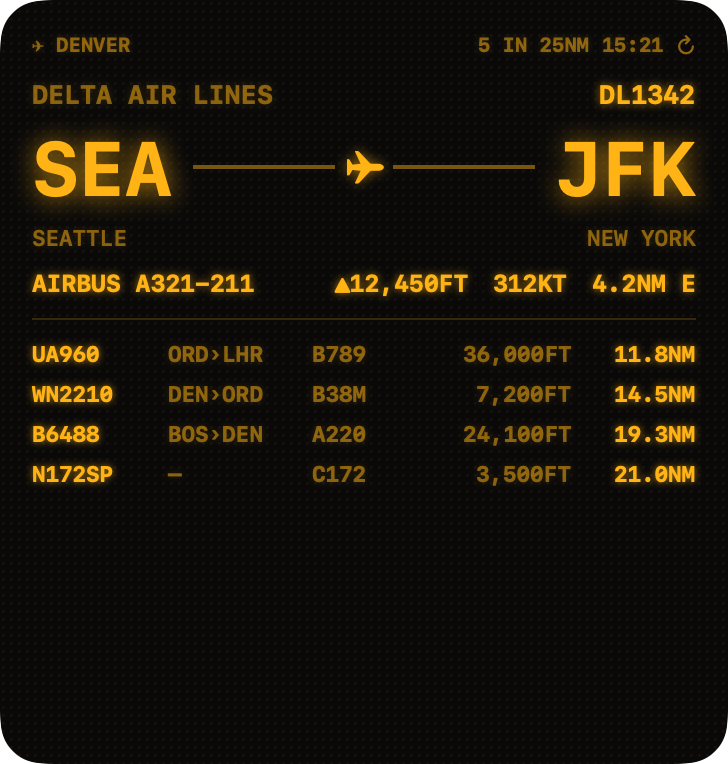
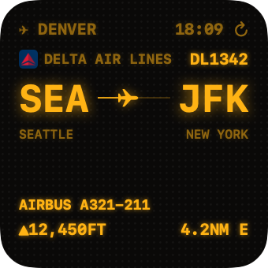

<p align="center">
  
</p>

<h1 align="center">FlightDesk</h1>

<p align="center">
  A native macOS desktop widget that shows the aircraft flying over you right now.<br>
  Choose a glowing LED flight board or a clean Standard look that follows Light and Dark Mode.
</p>

<p align="center">
  
  &nbsp;
  
</p>

## Features

- **Native desktop widget (WidgetKit).** Comes in Small, Medium, Large and Extra Large. It lives in *Edit Widgets* next to Apple's own widgets.
- **Live data.** Aircraft positions come from real-time ADS-B/MLAT. Between fetches, the widget moves each aircraft along its live heading, speed and climb rate every 15 s.
- **Verified routes.** Origin and destination come from a public database. Each route is checked against the aircraft's live position and heading, and routes that don't fit are hidden. This catches stale or reused callsigns.
- **Live progress.** The plane slides along the route line to show how far into the flight it is.
- **Flight details.** Click a flight in the widget (or the desktop panel) to open a live map with its route, its recorded track since takeoff, every flight within your search radius (drawn as a circle) and full details, including a photo of the airframe and where to look for it in your sky. Click any other plane on the map to switch to it.
- **Airline logos.** Downloaded once and cached (can be turned off in Settings).
- **Two looks.** Choose an LED board (amber, green, red, blue, cyan or white, with optional glow and dot-matrix texture) or **Standard**, which uses system colours and follows Light and Dark Mode. Both work with the macOS *Clear* and *Tinted* widget styles.
- **Configurable.** Set the location, radius (5–100 nm), units (ft/kt/nm or metric) and which details appear. Each widget can also override the location, radius, style, colour and units.
- **Live radar window.** Open FlightDesk from the Dock, Launchpad or Spotlight to get a map of your area with every aircraft in your search radius, drawn to its heading and size and moving in real time. A sidebar lists them with logos, routes, altitude and distance. You can search it by callsign, registration, type, airline or airport, and sort it by distance or altitude. Select a flight to see it in the inspector and on the map with its flown path, the dashed route still to go and its origin and destination airports. Double-click it (or click **Open Details**) for the full detail.
- **Menu bar and desktop panel.** A ✈ menu bar item gives quick access to the window, Settings and an optional floating panel that updates every 15 s. Closing the window keeps the menu bar item, panel and widgets running.
- **Your own receiver.** Running a Raspberry Pi feeder? FlightDesk can read positions straight from it over your local network: no rate limits, no internet needed, your own coverage. See [Use your own ADS-B receiver](#use-your-own-ads-b-receiver).
- **Private by design.** No accounts, no API keys and no analytics. See [Privacy](#privacy).

<p align="center">
  
  &nbsp;
  
  &nbsp;
  
</p>

## Requirements

- macOS 14 Sonoma or later
- Xcode 26 or later, plus [XcodeGen](https://github.com/yonaskolb/XcodeGen) (`brew install xcodegen`)
- An Apple ID signed in to Xcode. A free account works, because widgets must be code-signed.

## Install

```sh
git clone https://github.com/BadWasabeee/flightdesk.git
cd flightdesk
./build.sh
```

`build.sh` does the following:
1. Reads your Team ID from your Apple Development certificate and saves it to `Config/Local.xcconfig`. This file is git-ignored.
2. Generates the Xcode project and builds a Release copy.
3. Installs it to `~/Applications` and launches it.

Then add the widget: **right-click the desktop › Edit Widgets… › search "FlightDesk"** and drag a size onto your desktop.

| Command | What it does |
| --- | --- |
| `./build.sh` | Build, install and launch |
| `./build.sh --no-open` | Build and install |
| `./build.sh --test` | Run the unit tests |

To work in Xcode, run `xcodegen generate` and open `FlightDesk.xcodeproj`.

## Configuration

**Settings** opens inside the main window (**FlightDesk › Settings…** or ⌘, in the app, or **Settings…** in the ✈ menu). Its tabs replace the flight list in the sidebar; **Back** (the toolbar chevron, ⌘[ or Esc) returns to the map or flight you were looking at. Settings controls every widget, the panel and the main window:

| Tab | Options |
| --- | --- |
| General | Location (this Mac's location, a city/airport, or `lat, lon`), radius, private/GA traffic, menu bar readout, floating panel, launch at login |
| Display | Live preview, style (LED Board or Standard), colour, glow, dot-matrix texture, units, header, flight list, city names, logos, rotation |
| Widget | How to add the widget, how often to update it (15 s – 5 min), refresh now |
| Alerts | Notifications for emergency squawks, your watchlist, interesting (military, government) aircraft, heavies and aircraft passing close by; quiet hours |
| Sources | Your own ADS-B receiver, the data sources in use |

Links of the form `flightdesk://settings/<general|display|widget|alerts|sources>` open a tab directly.

**Per-widget overrides:** right-click a widget › *Edit "Flights Overhead"* to set its location, style, radius, colour and units. Everything else follows Settings.

**Main window:** the toolbar has the search radius, a **Private & GA** toggle and Refresh (⌘R). Hide the flight list with ⌃⌘S. Clicking FlightDesk in the Dock, or an empty part of a widget, brings the window back. When macOS opens FlightDesk at login, it starts in the menu bar without opening the window.

macOS decides when a widget actually redraws. While FlightDesk is running it asks for a refresh on the schedule you choose, which is 30 s by default. The ↻ button on a widget refreshes it immediately.

### Use your own ADS-B receiver

If you run dump1090-fa (PiAware / SkyAware), readsb, tar1090 or ultrafeeder, open **Settings › Sources**, turn on **Use my ADS-B receiver** and enter the address of its map page, for example `http://raspberrypi.local/tar1090`, `http://piaware.local/skyaware` or `http://192.168.1.50:8080`. **Test Connection** finds the receiver's `aircraft.json` (it tries `data/aircraft.json`, `aircraft.json` and the usual `tar1090/`, `skyaware/`, `dump1090-fa/` and `dump1090/` sub-paths) and shows how many aircraft it sees.

FlightDesk then asks your receiver first and computes distances itself. If the receiver can't be reached it falls back to the internet feeds and retries the receiver a minute later. Turn on **Only use my receiver** to never use the internet feeds. macOS asks once for permission to access your local network; you can change this in System Settings › Privacy & Security › Local Network. Plain `http://` works for IP addresses and `.local` names.

## How it works

```
App/      Mac app: main radar window and menus, location, settings, floating panel, widget refresh scheduling
Widget/   WidgetKit extension: timeline provider, Edit Widget options, refresh intent
Shared/   Models, data service, route verification, dead reckoning, views (used by both targets)
Tests/    Unit tests for route verification, projection, parsing and settings decoding
Config/   xcconfig (Team ID, bundle IDs, App Group), entitlements, Info.plist keys
```

The app and widget share settings, your location and a lookup cache through an App Group container.
Each widget refresh fetches nearby aircraft and adds aircraft and route details for the closest ones. Lookups are cached for 6 h (routes) and 30 days (aircraft). It then builds a 5-minute timeline of dead-reckoned frames.

### Data sources

| Data | Source |
| --- | --- |
| Live positions, altitude, speed, heading | Your own ADS-B receiver if you set one up, otherwise [adsb.fi](https://adsb.fi) open data, with [adsb.lol](https://adsb.lol) (ODbL) as an automatic fallback. Both are community-run ADS-B/MLAT feeds |
| Routes, airlines, aircraft models | [adsbdb](https://www.adsbdb.com) |
| Recorded flight tracks (detail window) | [OpenSky Network](https://opensky-network.org), anonymous access |
| Aircraft photos (detail window) | [Planespotters.net](https://www.planespotters.net) public photo API, credited to each photographer and linked to the photo page. Lookups are cached for 7 days (1 day when there's no photo) |
| Airport locations (bundled) | [OurAirports](https://ourairports.com/data/), public domain |
| Interesting-aircraft alerts (downloaded at runtime and refreshed weekly, not included in this repo) | [plane-alert-db](https://github.com/sdr-enthusiasts/plane-alert-db) by sdr-enthusiasts and contributors, fetched from GitHub. The download sends nothing about you |
| Airline logos (downloaded at runtime, not included in this repo) | [Soaring Symbols](https://github.com/soaring-symbols/soaring-symbols) icons (catalog data MIT), then [Jxck-S/airline-logos](https://github.com/Jxck-S/airline-logos) and [sexym0nk3y/airline-logos](https://github.com/sexym0nk3y/airline-logos) via [jsDelivr](https://www.jsdelivr.com) / GitHub, then [Kiwi.com](https://www.kiwi.com)'s logo CDN; only transparent-background logos are kept. Logos are trademarks of their respective airlines. |

These are free community services. Please be kind to them, and consider supporting them or contributing a feeder.

## Privacy

- The flight detail window looks up the selected aircraft's track on the [OpenSky Network](https://opensky-network.org) by its ICAO address only.
- The flight detail window asks [Planespotters.net](https://www.planespotters.net) for a photo of the selected aircraft by its ICAO address (or registration) only.
- Airline logos are fetched by airline code only (ICAO and/or IATA, never your location) from jsDelivr, GitHub (raw.githubusercontent.com) and Kiwi.com's logo CDN, then cached on your Mac. Turn off **Show airline logos** to disable this.

- Your location stays on your Mac. Requests to adsb.fi and adsb.lol include only a **rounded** position (about 1 km).
- With your own receiver, FlightDesk only downloads its aircraft list over your local network; your position is never sent to it. With **Only use my receiver**, no position requests go to the internet at all.
- adsbdb receives only flight callsigns and aircraft hex codes.
- There are no accounts, analytics or tracking. Settings live in the App Group container on your Mac.

## Contributing

Issues and pull requests are welcome. Please run `./build.sh --test` before opening a PR.
To render every widget size to PNG (handy for UI changes), run:

```sh
FLIGHTDESK_SNAPSHOT_DIR=/tmp/shots FLIGHTDESK_SNAPSHOT_SAMPLE=1 FLIGHTDESK_SNAPSHOT_STYLE=standard FLIGHTDESK_SNAPSHOT_SCHEME=dark \
  ~/Applications/FlightDesk.app/Contents/MacOS/FlightDesk
```

## License

[MIT](LICENSE) © 2026 Simon Degnan
