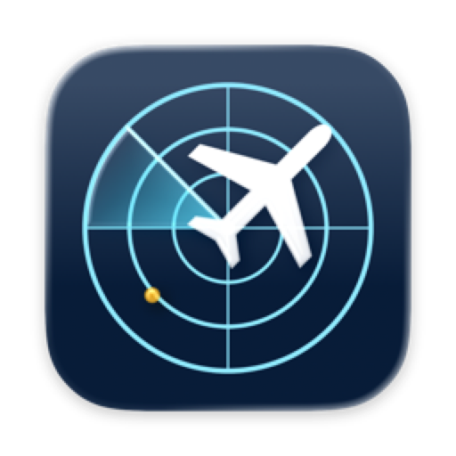
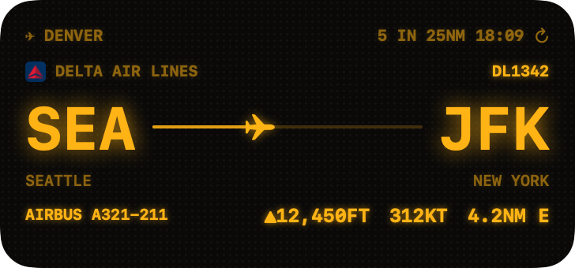
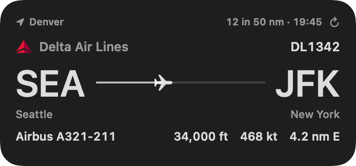
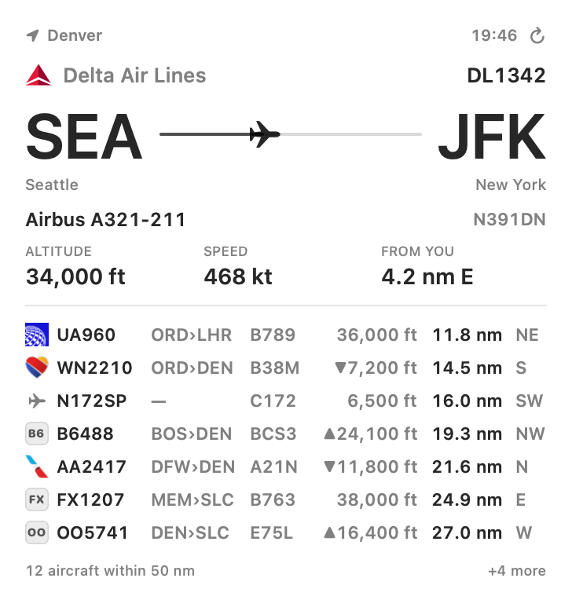

<p align="center">
  
</p>

<h1 align="center">FlightDesk</h1>

<p align="center">
  A native macOS desktop widget that shows the aircraft flying over you right now.<br>
  Choose a glowing LED flight board or a clean Standard look that follows Light and Dark Mode.
</p>

<p align="center">
  
  &nbsp;
  
</p>

## Features

- **Native desktop widget (WidgetKit).** Comes in Small, Medium, Large and Extra Large. It lives in *Edit Widgets* next to Apple's own widgets.
- **Live data.** Aircraft positions come from real-time ADS-B/MLAT. Between fetches, the widget moves each aircraft along its live heading, speed and climb rate every 15 s.
- **Verified routes.** Origin and destination come from a public database. Each route is checked against the aircraft's live position and heading, and routes that don't fit are hidden. This catches stale or reused callsigns.
- **Live progress.** The plane slides along the route line to show how far into the flight it is.
- **Flight details.** Click a flight in the widget (or the desktop panel) to open a live map with its route, its recorded track since takeoff, every flight within your search radius (drawn as a circle) and full details. Click any other plane on the map to switch to it.
- **Airline logos.** Downloaded once and cached (can be turned off in Settings).
- **Two looks.** Choose an LED board (amber, green, red, blue, cyan or white, with optional glow and dot-matrix texture) or **Standard**, which uses system colours and follows Light and Dark Mode. Both work with the macOS *Clear* and *Tinted* widget styles.
- **Configurable.** Set the location, radius (5–100 nm), units (ft/kt/nm or metric) and which details appear. Each widget can also override the location, radius, style, colour and units.
- **Menu-bar app.** Includes a Settings window with a live preview and an optional floating panel that updates every 15 s.
- **Private by design.** No accounts, no API keys and no analytics. See [Privacy](#privacy).

<p align="center">
  
  &nbsp;
  
  &nbsp;
  
</p>

## Requirements

- macOS 14 Sonoma or later
- Xcode 26 or later, plus [XcodeGen](https://github.com/yonaskolb/XcodeGen) (`brew install xcodegen`)
- An Apple ID signed in to Xcode. A free account works, because widgets must be code-signed.

## Install

```sh
git clone https://github.com/BadWasabeee/flightdesk.git
cd flightdesk
./build.sh
```

`build.sh` does the following:
1. Reads your Team ID from your Apple Development certificate and saves it to `Config/Local.xcconfig`. This file is git-ignored.
2. Generates the Xcode project and builds a Release copy.
3. Installs it to `~/Applications` and launches it.

Then add the widget: **right-click the desktop › Edit Widgets… › search "FlightDesk"** and drag a size onto your desktop.

| Command | What it does |
| --- | --- |
| `./build.sh` | Build, install and launch |
| `./build.sh --no-open` | Build and install |
| `./build.sh --test` | Run the unit tests |

To work in Xcode, run `xcodegen generate` and open `FlightDesk.xcodeproj`.

## Configuration

**FlightDesk Settings** (click ✈ in the menu bar, then Settings…) controls every widget and the panel:

| Tab | Options |
| --- | --- |
| General | Location (this Mac's location, a city/airport, or `lat, lon`), radius, private/GA traffic, launch at login |
| Display | Style (LED Board or Standard), colour, glow, dot-matrix texture, units, city names, flight list, header, rotation, floating panel |
| Widget | How often to fetch new data (15 s – 5 min), refresh now |

**Per-widget overrides:** right-click a widget › *Edit "Flights Overhead"* to set its location, style, radius, colour and units. Everything else follows Settings.

macOS decides when a widget actually redraws. While FlightDesk is running it asks for a refresh on the schedule you choose, which is 30 s by default. The ↻ button on a widget refreshes it immediately.

## How it works

```
App/      Menu-bar app: location, settings window, floating panel, widget refresh scheduling
Widget/   WidgetKit extension: timeline provider, Edit Widget options, refresh intent
Shared/   Models, data service, route verification, dead reckoning, views (used by both targets)
Tests/    Unit tests for route verification, projection, parsing and settings decoding
Config/   xcconfig (Team ID, bundle IDs, App Group), entitlements, Info.plist keys
```

The app and widget share settings, your location and a lookup cache through an App Group container.
Each widget refresh fetches nearby aircraft and adds aircraft and route details for the closest ones. Lookups are cached for 6 h (routes) and 30 days (aircraft). It then builds a 5-minute timeline of dead-reckoned frames.

### Data sources

| Data | Source |
| --- | --- |
| Live positions, altitude, speed, heading | [adsb.lol](https://adsb.lol), community-run, ODbL-licensed ADS-B/MLAT feed |
| Routes, airlines, aircraft models | [adsbdb](https://www.adsbdb.com) |
| Recorded flight tracks (detail window) | [OpenSky Network](https://opensky-network.org), anonymous access |
| Airport locations (bundled) | [OurAirports](https://ourairports.com/data/), public domain |
| Airline logos (downloaded at runtime, not included in this repo) | [Soaring Symbols](https://github.com/soaring-symbols/soaring-symbols) icons (catalog data MIT), then [Jxck-S/airline-logos](https://github.com/Jxck-S/airline-logos) and [sexym0nk3y/airline-logos](https://github.com/sexym0nk3y/airline-logos) via [jsDelivr](https://www.jsdelivr.com) / GitHub, then [Kiwi.com](https://www.kiwi.com)'s logo CDN; only transparent-background logos are kept. Logos are trademarks of their respective airlines. |

These are free community services. Please be kind to them, and consider supporting them or contributing a feeder.

## Privacy

- The flight detail window looks up the selected aircraft's track on the [OpenSky Network](https://opensky-network.org) by its ICAO address only.
- Airline logos are fetched by airline code only (ICAO and/or IATA, never your location) from jsDelivr, GitHub (raw.githubusercontent.com) and Kiwi.com's logo CDN, then cached on your Mac. Turn off **Show airline logos** to disable this.

- Your location stays on your Mac. Requests to adsb.lol include only a **rounded** position (about 1 km).
- adsbdb receives only flight callsigns and aircraft hex codes.
- There are no accounts, analytics or tracking. Settings live in the App Group container on your Mac.

## Contributing

Issues and pull requests are welcome. Please run `./build.sh --test` before opening a PR.
To render every widget size to PNG (handy for UI changes), run:

```sh
FLIGHTDESK_SNAPSHOT_DIR=/tmp/shots FLIGHTDESK_SNAPSHOT_SAMPLE=1 FLIGHTDESK_SNAPSHOT_STYLE=standard FLIGHTDESK_SNAPSHOT_SCHEME=dark \
  ~/Applications/FlightDesk.app/Contents/MacOS/FlightDesk
```

## License

[MIT](LICENSE) © 2026 Simon Degnan
